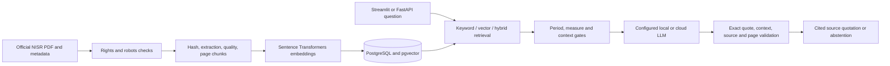

# FinRAG - Rwanda Financial Intelligence

A source-traceable financial research demonstration built with FastAPI, Streamlit, PostgreSQL/pgvector, Sentence Transformers and a real local Qwen LLM. The existing six-page application and SQLite demonstration are preserved.

**Verified local state, 17 November 2026:** 30 official NISR publications, 839 page-linked passages, 384-dimensional semantic embeddings, 72 passing automated tests, actual HTTP RAG, and an independent-from-tuning 30-question holdout. No public deployment is claimed. Repository: https://github.com/Ruganji-Prince/FINRAG.

**Accuracy limit:** the holdout achieved 100% exact quotation/citation integrity and refused all 6 unsupported requests, but unnecessarily refused 6/24 supported questions and achieved only 41.7% expected-anchor coverage. Some genuine source quotations answer the wrong measure or contain table/chart fragments. These are automated diagnostics, not human-reviewed accuracy. This is a production-oriented engineering demonstration, not a bank-ready decision system. The complete results and outstanding work are in [the completion report](docs/FINAL_PROJECT_COMPLETION_REPORT.md).

## Current upload status

This repository includes work in progress from the reliability-improvement investigation. The original 30-question holdout result (41.7% expected-statistic coverage) is preserved; no improved independent holdout result is claimed. Current changes add financial query normalization, report-period/topic filters, source-local context qualification, and supplementary sentence/layout evidence. Their accuracy evaluation and end-to-end UI verification are unfinished.

The original snapshot contains 30 publications and 839 passages. An operator refinement run added 755 supplementary evidence units locally (1,594 total); original chunks and citation IDs were retained. Run `python scripts/run_profile.py native -m pipelines.refine` after hydrating original PDFs to reproduce that refinement. The bundled snapshot remains the original 839-passage baseline. Historical completion reports describe the earlier verified checkpoint; read this status and `docs/PUBLICATION_STATUS.md` for the current upload.

## Demonstrate the verified installation

From this project folder in PowerShell:

```powershell
.venv\Scripts\python.exe scripts/native_postgres.py status
.venv\Scripts\python.exe scripts/start.py
```

If the application is already running, the launcher reports occupied ports instead of starting duplicates. Open [Streamlit locally](http://127.0.0.1:8501) or [local FastAPI documentation](http://127.0.0.1:8000/docs). These are loopback addresses, not public hosting URLs.

1. In AI Research Assistant, select **GDP National Accounts 2025** and ask `What was GDP growth in 2025?`. The verified answer quotes 9.4% and links to its exact PDF page.
2. Compare **Consumer Price Index (CPI) - October 2026** and **September 2026**, with topic `urban CPI annual increase`. The verified comparison cites both reports: 19.5 and 17.2 percent.
3. Ask for the latest central bank policy rate. The static, NISR-only corpus refuses to invent one.
4. Inspect Document Library, Data Quality/governance and Evaluation. Development and holdout results are explicitly separated. Check the original PDF before using a financial statistic.

Screenshots from the actual browser are under [docs/screenshots](docs/screenshots); the verification JSON identifies the tested backend/provider. A mobile viewport was exercised; this is not a formal accessibility certification.

## Architecture and answer policy



The local model performs real autoregressive inference. Constrained decoding permits source quotations or abstention; it does not publish free-form financial synthesis. Cloud structured selections/quotes pass the same source/context validation. Quote support is not proof that a quote answers the question. No autonomous banking actions or investment transactions are exposed.

Keyword search uses PostgreSQL English full-text OR terms and `ts_rank_cd`. Vector search uses normalized MiniLM embeddings and pgvector cosine distance. Hybrid ranking uses equal-weight reciprocal rank fusion, `sum(1/(60+rank))`, over up to 60 candidates per channel. The same filters and top-k are used in comparisons. Hybrid did not beat keyword on either saved benchmark.

The serving process uses a database reader role; migration/ingestion use a separate writer. Versioned SQL migrations are transactional and checksum-verified. GIN full-text, HNSW vector and metadata/page indexes are present. SQLite remains a deliberately lightweight keyword/hash mode. Detailed design: [architecture](docs/architecture.md), [PostgreSQL operations](docs/postgres.md), [security review](docs/security-review.md), [evaluation](docs/evaluation.md), [governance registry](docs/governance.json).

## Fresh installation

Python 3.14 was tested on Windows. Allow several GB of model downloads and approximately 10 GB RAM for local-model serving, plus database/frontend resources. GPU is not required. Model caches and runtime binaries are not distributed in the release.

```powershell
python -m venv .venv
.venv\Scripts\python.exe -m pip install --upgrade pip==26.3
.venv\Scripts\python.exe -m pip install -r requirements-embeddings.txt -r requirements-dev.txt
Copy-Item .env.example .env
```

Choose a database path:

- **Native Windows, verified here:** install the pinned PostgreSQL 16.15/pgvector 0.8.6 packages using the micromamba instructions in [docs/postgres.md](docs/postgres.md), then run the commands below. Do not put a production database inside a cloud-synced Box folder.
- **Docker Compose, configured but not runtime-verified here:** follow [docs/deployment.md](docs/deployment.md). Docker and WSL are absent on this machine. Schema validation is not a substitute for running containers.

For a fresh native installation after installing the database binaries:

```powershell
.venv\Scripts\python.exe scripts/native_postgres.py start
.venv\Scripts\python.exe scripts/run_profile.py native -m backend.migrate
.venv\Scripts\python.exe scripts/run_profile.py native -m pipelines.snapshot restore data/prebuilt-semantic-index-v3.json
.venv\Scripts\python.exe scripts/configure_native.py
.venv\Scripts\python.exe scripts/start.py
```

The new snapshot contains 30 licensed text/vector derivatives, without original PDFs. To hydrate original PDF caches and verify incremental ingestion, use the writer profile:

```powershell
.venv\Scripts\python.exe scripts/run_profile.py native -m pipelines.ingest data/manifest.json
```

Source URLs, title, date basis, page references, SHA256, retrieval timestamps, quality status and attribution are preserved. Duplicate hashes are audited and skipped; missing original PDF caches are restored. Changed content becomes a new version. BNR reports remain pending rights clarification and are excluded from the corpus and distributed PDFs. NISR data/analysis is attributed under [CC BY 4.0 terms](https://statistics.gov.rw/terms-use); embedded overrides apply and images/logos are excluded. See [source catalogue](docs/source-catalogue.json) and [BNR review](docs/bnr-source-review.json).

To migrate your existing SQLite evidence instead of restoring a snapshot:

```powershell
.venv\Scripts\python.exe scripts/run_profile.py native -m pipelines.migrate_sqlite --source data/finrag.db
.venv\Scripts\python.exe scripts/run_profile.py native -m pipelines.reembed
```

The transfer verifies source text/page identity and governance payloads and records lineage. Back up before migration. Do not run concurrent ingestion/reindex maintenance. Original snapshots and earlier evaluation artifacts remain available.

For the original two-report SQLite demonstration, install `requirements.txt` only, set `.env` to `DATABASE_URL=sqlite:///data/finrag.db`, `QUERY_DATABASE_URL=`, `EMBEDDING_BACKEND=hash`, `LLM_PROVIDER=none`, `AUTO_MIGRATE=true`, `PRELOAD_MODELS=false`, then:

```powershell
.venv\Scripts\python.exe scripts/run_profile.py sqlite -m pipelines.snapshot restore
.venv\Scripts\python.exe scripts/start.py
```

## Providers, credentials and security

The verified local profile uses `LLM_PROVIDER=local`, pinned `Qwen/Qwen2.5-1.5B-Instruct`, float32 CPU inference and pinned `all-MiniLM-L6-v2`. Upgraded model libraries were audited and recalibrated. Int8 and earlier model failures remain recorded; they are not promoted as successful results.

Cloud configuration uses `LLM_PROVIDER=openai` or `gemini`, `LLM_API_KEY`, and an authorized `LLM_MODEL` in a private environment. Optionally supply `INPUT_COST_PER_MILLION` and `OUTPUT_COST_PER_MILLION`; prices are operator inputs, not embedded current price claims. No valid cloud key was supplied, so live cloud behavior and billing remain unverified. Mocked adapter tests are labeled as such. Cloud calls have bounded timeouts and at most two selective retries; ambiguous read timeouts are not retried. Provider/validation failure abstains and retains evidence. There is no automatic paid fallback. `LLM_PROVIDER=none` explicitly selects retrieval-only mode.

Keep `.env`, `.env.native-postgres` and `.runtime/local-secrets.json` private. Public-mode API startup requires `PUBLIC_MODE=true` and `API_ACCESS_TOKEN` of at least 32 characters; the Streamlit server receives this token server-side. Use HTTPS and an authenticated gateway before exposing the frontend; shared API tokens are not enterprise identity/RBAC. Loopback ports are intentional. Body/query/rate/generation limits and reader-only database credentials reduce exposure but do not replace load testing or a security assessment.

## Measured evaluation

The development evaluation (`rag-latest.json`) was tuned on 32 cases over the earlier 15-report corpus. Its 100% anchor result is preserved as development evidence and must not be represented as holdout accuracy.

The new 30-question holdout includes 24 supported questions and 6 unsupported/adversarial requests. Twenty-six original PDF page references were hash/page/anchor-verified. Backend hashes were frozen before dataset creation and remained unchanged during evaluation. Some CPI templates resemble development tasks; the benchmark was agent-authored, not independently human-authored.

| Holdout retrieval, same questions/filters | Page Recall@5 | MRR@5 |
|---|---:|---:|
| Keyword | 1.0000 | 0.8646 |
| Vector | 0.6458 | 0.2431 |
| Hybrid | 0.7500 | 0.3611 |

Actual hybrid HTTP/LLM evaluation: quotation/citation integrity 100% across 18 generated responses; unsupported abstention 6/6; supported-question abstention 6/24; expected-anchor coverage 10/24 (41.7%); mean server latency 17.76 seconds across all 30 requests, including fast refusals. Successful inference recorded 8,496 prompt and 1,686 completion tokens; cloud API fee was $0 for local inference. Hardware/energy cost and human accuracy are unmeasured. Fourteen diagnostic failure cases are retained without post-holdout tuning.

See [holdout results](evaluation/results/holdout-rag.json), [retrieval comparison](evaluation/results/holdout-retrieval.json), [failure cases](evaluation/results/holdout-failure-cases.json), [freeze record](evaluation/results/holdout-freeze.json) and [human-review package](evaluation/human-review/README.md). Human-reviewed count is **zero**.

## Verification and release

```powershell
.venv\Scripts\python.exe scripts/run_checks.py --postgres --models
.venv\Scripts\python.exe -m ruff check .
.venv\Scripts\python.exe -m pip check
.venv\Scripts\python.exe -m pip_audit --format json --output evaluation/results/dependency-audit-upgraded.json
.venv\Scripts\python.exe scripts/api_smoke.py
.venv\Scripts\python.exe scripts/security_smoke.py
.venv\Scripts\python.exe scripts/browser_smoke.py
.venv\Scripts\python.exe scripts/prepare_release.py
```

`pip-audit` requires `requirements-security.txt`; browser verification requires `requirements-browser.txt` and Edge/Chromium. Full native/model test run: **72 passed, zero failed/skipped**. Current installed-environment audit: zero known findings. CI includes lint, dependency compatibility, release scanning and PostgreSQL tests, plus manual semantic integration; remote workflow execution is not claimed.

`prepare_release.py` writes a publication allowlist, configured-secret/pattern scan and ZIP under ignored `release/`. It excludes secrets, raw/review PDFs, databases, logs, caches, models, runtime binaries and backups. Review the manifest before publication. The owner authorized publication to `Ruganji-Prince/FINRAG`. Source, screenshots, tests and evaluation evidence are included, while private runtime data is excluded. A GitHub repository is not a deployed application. Hosting feasibility and paid-service prerequisites are documented in [hosting assessment](docs/hosting-assessment.md).

No source-code license has been selected by the owner; publishing visibility alone does not grant a permissive source-code license. Dataset reuse follows the separate attribution/rights notes above. DAMA-inspired governance is demonstrated through stored metadata, quality, lineage, ownership and version records; no DAMA or banking certification is claimed.
