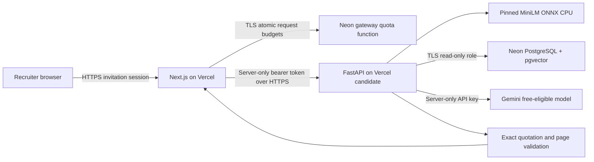

# Recruiter demonstration deployment

Status: deployment preparation, not a verified public service. No paid resources or billing have been enabled. Preserve the original 41.7% holdout expected-statistic coverage; ONNX compatibility is not a new accuracy evaluation.

## Architecture and necessary accounts

Only Vercel, Neon and Gemini are needed. **Upstash is not required.** PostgreSQL provides shared atomic quotas across serverless instances. Streamlit, SQLite and the local PostgreSQL/Qwen workflow remain separate working fallbacks. No local Qwen weights, PDFs, databases or secrets are deployed.

## 1. Neon Free account and database

1. Open https://console.neon.tech and sign up/sign in. Choose **Free**, without adding a card or enabling billing. Review provider terms yourself.
2. Create a dedicated FinRAG project, PostgreSQL 16 if offered, in a US East region near Vercel `iad1`. Use a new database, never a company or production database.
3. Save the owner connection URL privately in a local environment manager. Require TLS (`sslmode=require` or certificate verification). Never paste it into chat, Git or a screenshot.
4. In the SQL editor enable `CREATE EXTENSION IF NOT EXISTS vector;`. Create SQL roles `finrag` (ingestion writer) and `finrag_reader` (LOGIN, NOSUPERUSER, NOCREATEDB, NOCREATEROLE). Do not use the owner role in the application. Set their passwords using a private parameterized operator session; no passwords belong in checked-in SQL.
5. Grant the writer usage/create on the application schema; grant the reader usage and SELECT on the financial tables, sequences only if required. Set `ALTER ROLE finrag_reader SET default_transaction_read_only=on;`. Set writer default privileges to grant the reader SELECT on future tables. Do not grant access to all unrelated schemas/databases. SQL-created roles avoid elevated console-role defaults.
6. In a private operator shell set `DATABASE_URL` to the writer URL, `QUERY_DATABASE_URL` to the reader URL, and `AUTO_MIGRATE=true`. From the repository run `python -m pipelines.snapshot restore data/prebuilt-semantic-index-v3.json`, then `python -m pipelines.sync_governance governance docs/governance.json` and `python -m pipelines.sync_governance query-policy docs/query-policy.json`. This preserved licensed snapshot has **30 documents / 839 passages**. The local supplementary 1,594-passage development index is not silently substituted for this reproducible snapshot.
7. Set private `QUOTA_ADMIN_DATABASE_URL` to the owner URL and run `python scripts/setup_gateway_quota.py`. It applies `deploy/postgres/gateway-quota.sql` in one transaction. Set a strong unique password privately for `finrag_gateway`. Give the frontend only its pooled TLS URL. It can execute the quota function, not read financial tables or alter quota policy. Verify these privileges before deployment.
8. Unset operator URLs after initialization. Use Neon's pooled connection endpoint for deployed roles. The backend reader must be named `finrag_reader`; frontend quota role must be `finrag_gateway`. Neither runtime receives an owner/writer URL.

Default shared limits: 5 query requests/minute/session, **20 query requests/day across the demonstration**, 5 login attempts/minute/IP-derived identity, 200 login attempts/day globally, 60 reads/minute/session and 5,000 reads/day globally. A comparison can invoke multiple model calls. Limits consume allowances before processing and fail closed when PostgreSQL is unavailable. Only the operator may change the daily query policy (hard range 1-100). No guaranteed availability or adversarial denial-of-service protection is claimed.

## 2. Gemini free account and key

1. Open https://aistudio.google.com and sign in; confirm availability and terms for your account/location.
2. Create/select a dedicated project and generate a Gemini API key using AI Studio's current supported key workflow. Restrict it to the Generative Language API where available.
3. Keep the project on the **free tier**. Do not attach billing, buy credits or select a paid-only model. Choose an explicitly free-eligible text model shown in your account and record its exact identifier in `LLM_MODEL`.
4. Store the key only in the backend Vercel environment as `LLM_API_KEY`. Set `LLM_PROVIDER=gemini`. Do not put it in the frontend or use a `NEXT_PUBLIC_` variable.
5. Free-tier prompts/content may be used to improve Google's products. This demo accepts only public, non-confidential research questions. Free quotas depend on the account/model and can change. Treat provider 429/timeouts as unavailable, never substitute invented answers.

## 3. Backend Vercel candidate

Vercel CLI authentication was confirmed for the existing account; no new project or resources have been created by this preparation. Keep the existing PV Anomaly project untouched.

1. Install Python dependencies in a virtual environment, then run `python -m scripts.prepare_vercel_api`. It stages `release/vercel-api`, downloads immutable publisher-verified Apache-2.0 MiniLM ONNX assets, and excludes private data and local LLM weights.
2. Use a separate Vercel project for this API, rooted in the staging directory. See `deploy/vercel-api/pyproject.toml` and `vercel.json`. Python 3.14, CPU ONNX, batch 8, maximum duration 180 seconds. Do not install the full Torch/Streamlit requirements in this function.
3. Set the backend environment variables listed below through Vercel Settings / Environment Variables. Use the reader's TLS URL for **both** database URL fields. Use a randomly generated bearer token of at least 32 characters.
4. Deploy using the normal Vercel CLI from the staging directory after configuration. Verify the actual Linux build fits the standard Python function bundle limit before promotion. Verify unauthenticated health/query calls return 401 and authenticated health/database requests succeed.
5. A local Windows probe measured approximately 279 MB installed dependencies plus assets and 349 MB peak process memory. These are feasibility evidence, **not an actual Vercel build**. If bundle size, cold starts or latency fail, pause and assess an external CPU backend; do not purchase a host automatically.

## 4. Frontend Vercel project

1. Import the existing `Ruganji-Prince/FINRAG` repository into a separate frontend project. Root directory **web**, framework Next.js, Node 24, install `npm ci`, build `npm run build`. Keep the Hobby plan.
2. Configure the variables below. Generate `SESSION_SECRET` independently from the bearer token and invitation code. Use at least 32 random characters for the session secret and at least 16 for the invitation code. Store values directly in the provider's secret environment UI, never in chat.
3. Set `APP_ORIGIN` to the exact stable frontend HTTPS origin, without a trailing path. Set `BACKEND_URL` to the authenticated API's HTTPS origin. The server-to-server bearer token must match backend `API_ACCESS_TOKEN`.
4. `LOCAL_DEMO_MODE=false` in all hosted environments. The application rejects local-mode sessions on Vercel. No Redis configuration is needed.
5. Configure production and preview variables intentionally; protect previews or omit credentials. Set an exact preview origin if testing an authenticated preview. Never grant untrusted pull-request deployments production secrets.
6. Redeploy after environment changes. Rotate invitation/session secrets to revoke shared access; distribute the invitation code privately to recruiters.

## Environment variables

| Project | Variables | Purpose |
| --- | --- | --- |
| Frontend | `APP_ORIGIN`, `BACKEND_URL` | Exact HTTPS origins; no arbitrary proxy targets |
| Frontend secret | `BACKEND_API_TOKEN` | Matches backend bearer token |
| Frontend secret | `SESSION_SECRET`, `DEMO_ACCESS_PASSWORD` | Signed one-hour HttpOnly/Secure/SameSite sessions; shared invitation |
| Frontend secret | `QUOTA_DATABASE_URL` | TLS pooled URL for restricted gateway role |
| Frontend | `LOCAL_DEMO_MODE=false` | Mandatory hosted configuration |
| Backend secret | `API_ACCESS_TOKEN` | Strong bearer token; never browser-visible |
| Backend secret | `DATABASE_URL`, `QUERY_DATABASE_URL` | Same restricted reader TLS URL, not writer/owner |
| Backend secret | `LLM_API_KEY` | Gemini key only on backend |
| Backend | `LLM_PROVIDER=gemini`, `LLM_MODEL` | Account-verified free text model |
| Backend | `PUBLIC_MODE=true`, `HEALTH_REQUIRES_AUTH=true` | Authenticate API including health |
| Backend | `AUTO_MIGRATE=false`, `STARTUP_DATABASE_CHECK=false`, `PRELOAD_MODELS=false` | Operator-only DDL; bounded cold start |
| Backend | `EMBEDDING_BACKEND=onnx`, `EMBEDDING_BATCH_SIZE=8` | Compact CPU profile |
| Backend | `LLM_TIMEOUT_SECONDS=45`, `LLM_MAX_ATTEMPTS=1`, `LLM_MAX_TOKENS=1200` | Bound request/model work |

Templates: `web/.env.example` and `deploy/vercel-api/.env.example`. No actual credential is included. For local frontend work use a private ignored `web/.env.local`; set `LOCAL_DEMO_MODE=true` only on loopback. Run `npm ci`, `npm test`, `npm run typecheck`, `npm run build` from `web`. Preserve the existing README's Streamlit startup commands.

## 5. Acceptance gate before sharing a public URL

Check login, logout/expiry, cross-origin denial, request/body limits and backend bearer denial. Open all six pages on desktop/mobile. Run a supported GDP question and a cross-report CPI comparison against Neon + Gemini, verify each quotation exists in its cited passage/page, and test an unsupported financial statistic produces a refusal. Check corpus counts, TLS, read-only roles, quota exhaustion across multiple instances, cold-start latency and provider quota responses. Record model ID, deployment commit/URL and measured latency. Check secrets are absent from browser bundles, network responses, logs and Git. Until these checks pass, the public application is **not deployment-verified**.

## Costs and limits (checked 2026-11-17)

Target incremental cost: **$0 within eligible free quotas; no paid resource authorized**. Hobby use must satisfy Vercel's plan terms. Neon Free currently advertises 100 CU-hours/month/project and 1 GB storage, no card required. Gemini has limited free-model access; no universal fixed RPM quota is promised. Vercel Hobby functions currently have 2 GB memory / 1 vCPU and up to 300 seconds with Fluid Compute; standard Python bundles have a 500 MB uncompressed limit. We configure 180 seconds and do not depend on larger-function beta features. Cold starts, sleeping databases, shared invitations and quota exhaustion limit recruiter-demo availability. Free tiers are not production banking infrastructure.

Sources: [Vercel function limits](https://vercel.com/docs/functions/limitations), [Python runtime](https://vercel.com/docs/functions/runtimes/python), [Hobby terms](https://vercel.com/docs/plans/hobby), [Neon pricing](https://neon.com/pricing), [pgvector](https://neon.com/docs/extensions/pgvector), [Gemini pricing](https://ai.google.dev/gemini-api/docs/pricing), [Gemini keys](https://ai.google.dev/gemini-api/docs/api-key).
