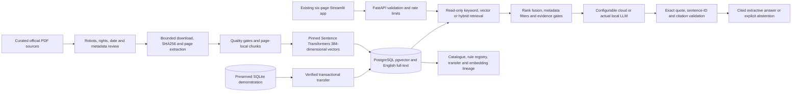

# Verified RAG architecture

## Storage and migration

The original SQLite schema/data and lightweight code path are preserved. Versioned SQL migrations now apply transactionally with an advisory lock in PostgreSQL and an immediate transaction in SQLite. Migration checksums detect edits to deployed SQL. The SQLite transfer copies metadata, passages, original audit entries and any database governance records, verifies exact text/page identity and records ID mappings and the logical source fingerprint. Original JSON governance is seeded in a governed registry table rather than falsely described as pre-existing SQLite data.

The schema includes document filters, source and document/page indexes, a GIN tsvector index and an HNSW cosine-vector index. Vectors retain their document model identity including immutable model revision. Re-embedding publishes selected document vectors and metadata atomically and records an embedding run. Corpus/model conflicts fail before publication. New/unchanged files are distinguished by content SHA256; unchanged documents are skipped, changed bytes create a new version. There is no automatic corpus deletion.

The serving profile uses only a reader-role connection and `AUTO_MIGRATE=false`. Operator commands receive a separate writer profile. The native reader was denied writes even after disabling its default read-only transaction setting. Production migration, ingestion and serving credentials should remain separate.

## Retrieval

Three configurations share identical source filters and top-k limits:

- Keyword: PostgreSQL English full-text OR query over normalized query tokens, ranked by `ts_rank_cd`.
- Vector: Sentence Transformers cosine similarity, ranked through pgvector.
- Hybrid: reciprocal rank fusion `sum(1 / (60 + rank))` over up to 60 candidates from each channel. Equal weights and stable ID tie-breaking are explicit; no unmeasured improvement is assumed.

Within retrieved passages, answer context is additionally reranked at sentence level using real embeddings. Numeric questions prefer sentences containing reported percentages. Annual/monthly frequency, urban/rural scope and GDP-growth versus deflator identities are preserved; missing matches cause pre-generation abstention. Repeated sentences are deduplicated and comparison context preserves report diversity. Original text and IDs are retained. This addresses observed header/methodology distraction; it does not prove relevance.

The benchmark compares ungated candidates so retrieval ranking is measured separately from answer refusal. Production answers use evidence gates. Hash/keyword paths retain conservative lexical overlap checks. Semantic paths use a configurable cosine floor. Explicit query years must intersect source passage/title years. That permits multi-report period comparisons; it does not prove all requested periods are covered. These gates are heuristics, and the LLM must still assess whether evidence answers the question.

## Real generation and grounding policy

Cloud adapters support OpenAI chat completions and Gemini generateContent using environment credentials. A real pinned Qwen 2.5 1.5B model provides a CPU-only alternative with no cloud API fee. Full precision passed factual calibration. An optional int8 trial failed calibration and is disabled by default; no accuracy or speed benefit is claimed for that trial. Source snippets are serialized as untrusted evidence with title, date, page and stable IDs. The local decoder is constrained to original source sentences or abstention; cloud selections/quotes are checked after generation.

The published answer is deliberately **extractive RAG**: a real LLM selects answer evidence, and the backend renders validated original quotations with citations. It does not publish unsupported free-form model prose. Every quote must be a contiguous exact passage after whitespace normalization, cite a retrieved chunk and reference an existing document/page. Unknown IDs, invented numbers in quotes, malformed outputs and incomplete cloud generations fail closed. Quotes are presented separately from interpretive caution; no cross-report causal explanation or financial recommendation is fabricated.

This verifies quote/citation integrity, not answer relevance, completeness or semantic entailment. A model can choose a true but irrelevant sentence or abstain excessively. Development trials of the smallest model exposed those failures; final measured model results must be read from evaluation artifacts. Questions asking for current/latest conditions abstain because the static corpus is incomplete. Personalized investment and transaction requests are refused.

## Operational boundaries

Input bounds, download limits, official URL allowlisting, redirect refusal, robots checks, request spacing, parameterized SQL, read-only roles and safe API errors remain active. Cloud credentials are never committed or copied into Docker build context. No questions are persisted by the application; the browser transcript is session-only. Benchmark questions/answers are intentionally public test artifacts. The local model is loaded once per API process and serialized for CPU inference. The service is designed for one research worker, not unbounded multi-tenant traffic.

Production still requires authentication, TLS, distributed quotas, PDF worker isolation, backup/restore drills, monitoring and a deployment-specific security review. Table text is flattened and scanned reports are flagged rather than given invented OCR output. Public source links can change; retained original hashes and cached PDF pages provide local verification. No institutional affiliation or consequential financial decision-making is claimed.
