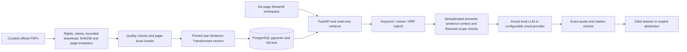

# FinRAG - Rwanda Financial Intelligence Assistant

Financial research over official publications with traceable document and page citations. This independent portfolio project is not affiliated with or endorsed by BNR or NISR. It does not execute transactions, provide personalized investment instructions or make consequential financial decisions.

The existing six-page application was extended in place to a genuine PostgreSQL/pgvector, Sentence Transformers and local-LLM workflow. SQLite remains an optional lightweight mode.

**Verified corpus:** 15 official NISR publications and 499 passages. **Full test suite:** 66 tests, 0 failures and 0 skipped. Actual HTTP RAG and browser checks passed. See the [implementation/test/incomplete report](docs/final-report.md).

## Open or restart the configured application

The supplied workspace has a configured environment, populated native PostgreSQL database and downloaded models. While running:

- Application: **http://127.0.0.1:8501**
- API/OpenAPI: **http://127.0.0.1:8000/docs**

```powershell
.venv\Scripts\python.exe scripts/native_postgres.py start
.venv\Scripts\python.exe scripts/configure_native.py
.venv\Scripts\python.exe scripts/start.py
```

The Python launcher avoids changing PowerShell execution policy. Do not launch duplicate processes on occupied ports. Model preloading delays initial readiness, and full-precision CPU generation is substantially slower than retrieval. Restart the API after configuration/model changes.

## Reproduce the genuine RAG path

Python 3.14.2 on Windows was verified. Dependencies are pinned:

```powershell
python -m venv .venv
.venv\Scripts\python.exe -m pip install -r requirements-embeddings.txt
```

Use `C:\Python314\python.exe` on this machine if the Python alias opens the Microsoft Store. On Linux/macOS use `.venv/bin/python`.

Follow [PostgreSQL operations](docs/postgres.md) for Docker or the tested native fallback. Docker/WSL were unavailable here: Compose schema and image availability were validated, but container execution is not claimed. Native PostgreSQL 16.15 / pgvector 0.8.6 was actually exercised.

Operator commands use a separate writer profile; the API receives only reader credentials and `AUTO_MIGRATE=false`:

```powershell
.venv\Scripts\python.exe scripts/run_profile.py native -m backend.migrate
.venv\Scripts\python.exe scripts/run_profile.py native -m pipelines.migrate_sqlite --source data/finrag.db
.venv\Scripts\python.exe scripts/run_profile.py native -m pipelines.reembed
.venv\Scripts\python.exe scripts/run_profile.py native -m pipelines.ingest data/manifest.json
```

The source-preserving transfer verifies original passages/pages and records document-ID mappings. Repeated logical sources skip without duplication. Real embeddings are published atomically while preserving text, IDs, pages and PDF hashes. Fresh deployments can restore `data/prebuilt-semantic-index.json` into a matching model configuration. Before independently verifying original-PDF benchmark anchors, run ingestion once to hydrate cached PDFs; unchanged document/chunk IDs are preserved.

The optional Compose `app` profile provides database, writer-only migration service, read-only API and Streamlit with a persistent model cache. Its runtime remains unverified; see [deployment instructions](docs/deployment.md).

## Lightweight offline demonstration

The original two-report snapshot and SQLite database were preserved. A separate 15-report lexical snapshot is also available:

```powershell
.venv\Scripts\python.exe -m pip install -r requirements.txt
.venv\Scripts\python.exe scripts/run_profile.py sqlite -m pipelines.snapshot restore data/prebuilt-index-v2.json
.venv\Scripts\python.exe scripts/run_profile.py sqlite -m uvicorn backend.main:app --host 127.0.0.1 --port 8000
```

Start Streamlit in another terminal: `.venv\Scripts\python.exe -m streamlit run app/streamlit_app.py`. This explicit profile uses lexical hash vectors and retrieval-only evidence, with no paid API or semantic model required. It does not present retrieval as an LLM answer. Restoring the expanded snapshot adds reports without duplicating existing hashes; `data/prebuilt-index.json` remains the original snapshot.

## Architecture and grounded generation



Embeddings use a pinned immutable revision of `sentence-transformers/all-MiniLM-L6-v2`, normalized to 384 dimensions. pgvector performs cosine search; PostgreSQL English full-text ranking supplies keyword candidates. Hybrid ranking uses equal-weight reciprocal rank fusion, `sum(1/(60+rank))`, over top-60 candidates per channel. Report ID/title, publisher, publication year and type filters remain available.

Context selection removes repeated sentences and reranks them with real embeddings. Conservative rules distinguish annual/monthly changes, urban/rural CPI and GDP growth versus the GDP deflator. Known unsupported banking indicators require explicit source coverage. These rules can reject valid paraphrases; they are not universal proof of answerability.

The application deliberately implements **extractive RAG**. A real LLM selects supporting evidence, and the backend publishes validated original quotations with page citations. Local decoding is constrained to actual source sentences or abstention. Cloud selections/quotes are checked after generation. Unknown IDs, invented quotations/numbers, out-of-context claims and incomplete provider outputs fail closed. Cross-report comparisons must support both selected reports. A true quote can still be irrelevant or incomplete, so human review remains necessary.

The tested local model is pinned Qwen 2.5 1.5B Instruct in full precision. Its weight file was verified against the publisher LFS SHA256. Smaller-model and int8 trials failed calibration and were not promoted as defaults. Local inference has no cloud API fee, but requires multi-GB storage/memory and meaningful CPU time.

For Gemini/OpenAI, configure `LLM_PROVIDER`, `LLM_API_KEY` and a compatible `LLM_MODEL` in private `.env`, then restart. Successful/adversarial mocked adapter tests passed; live cloud calls/billing were not verified without supplied credentials. Optional configured token prices are estimates, not live quotations.

## Official corpus, ingestion and governance

The indexed corpus contains ten CPI reports and five GDP reports from [official NISR publications](https://statistics.gov.rw/statistical-publications). NISR's [published reuse terms](https://statistics.gov.rw/terms-use) license data/analysis with attribution unless document-specific conditions override them. Extracted snapshots exclude third-party images/logos.

Each publication retains title, publisher, source/landing URLs, publication date and date-basis notes, retrieval time, exact pages, PDF SHA256 and embedding-model identity. CPI publication dates were checked against cover pages. Month-only dates and official last-updated proxies on other reports are explicitly identified, rather than claimed as independently verified exact release days.

BNR's public catalogue and priority report candidates were inspected under its robots rules. No clear reuse basis was established for the reviewed PDFs, so they remain outside the index pending rights review; see [the source-review record](docs/bnr-source-review.json). Banking/regulatory coverage is therefore incomplete, and unsupported policy-rate/risk questions abstain.

Ingestion validates metadata and official HTTPS hosts, refuses redirects, bounds downloads, respects robots/request spacing, preserves numeric text, rejects scanned/poor extraction, detects content/chunk duplicates and commits documents/chunks atomically. A real refresh of all 15 reports preserved 499 passages without adding duplicates. Failed sources never wipe existing data.

Governance is persisted: catalogue, metadata and quality-rule registry, source-rights records, transfer mappings, embedding-run lineage and ingestion audit. Explicit registry changes archive previous payloads and hashes. The actual reader role was denied writes even after its default read-only transaction flag was disabled. Private credentials, raw/review PDFs, runtime files and model caches are excluded from Git and Docker build context. Questions are not persisted; public benchmark artifacts are intentional test data.

## API and user interface

The existing Home, AI Research Assistant, Compare Reports, Document Library, Data Quality and Evaluation pages remain. Comparison accepts a precise financial topic/frequency, shows independent evidence and produces a joint cited answer when both reports support it. Chat history is session-only; follow-up coreference is not implemented.

| Endpoint | Purpose |
|---|---|
| `GET /health` | Database-ready runtime configuration |
| `POST /ask` | Generated cited answer or abstention |
| `POST /search` | `keyword`, `vector` or `hybrid` retrieval |
| `POST /compare` | Two-report evidence and cited comparison |
| `GET /documents` | Catalogue/provenance |
| `GET /quality` | Actual quality counts and audit |
| `GET /governance` | Persistent registries, versions and lineage |
| `GET /evaluation` | Saved generation/retrieval measurements |

```json
{"question":"What was GDP growth in 2025?","k":5,"retrieval_mode":"hybrid","filters":{"document_id":1}}
```

## Tests and actual evaluation

```powershell
.venv\Scripts\python.exe scripts/run_checks.py --postgres --models
.venv\Scripts\python.exe scripts/run_profile.py native -m evaluation.benchmark_v2
.venv\Scripts\python.exe scripts/run_profile.py native -m evaluation.compare_retrieval
.venv\Scripts\python.exe -m evaluation.evaluate_rag --balanced --api-url http://127.0.0.1:8000
```

The latest full suite recorded 66 tests, 0 failures and 0 skipped, including real database and semantic-model checks. One upstream Starlette/httpx deprecation warning remains. Coverage includes schema rollback, preserved migration, persistence/roles, ingestion/deduplication, retrieval modes, exact references, malformed claims, cloud contracts, scope/frequency context, API responses and governance history.

The 52-question retrieval benchmark checks original PDF hashes/pages/anchors. Many questions name/filter a report; independent human relevance review and held-out generalization evaluation remain pending.

| Configuration | Page Recall@5 | MRR@5 |
|---|---:|---:|
| keyword | 1.0000 | 0.9773 |
| vector | 0.9773 | 0.7803 |
| hybrid | 1.0000 | 0.9375 |

Hybrid did not outperform keyword MRR on this development dataset. The balanced **actual HTTP/local-LLM** evaluation is **completed (32/32 cases)**. Exact-source claim support is 1.0000; unsupported abstention is 1.0000; positive-question abstention is 0.0000; expected-anchor coverage is 1.0000; mean server latency is 25314.96 ms.

These are not human-verified accuracy scores. The original 32-case run had only 0.6071 expected-anchor coverage despite valid quotations; its [observed failures](evaluation/results/baseline-failure-cases.json) were retained before the corrected policy was rerun. Quote integrity is partly guaranteed by the extractive policy. Anchor coverage and saved failures expose relevance/completeness gaps. Results: [retrieval comparison](evaluation/results/retrieval-comparison.json), [actual generated answers](evaluation/results/rag-latest.json), [reference verification](evaluation/results/benchmark-verification.json), [failure diagnostics](evaluation/results/failure-cases.json) and [HTTP verification](evaluation/results/api-verification.json). See [evaluation methodology](docs/evaluation.md).

## Actual screenshots


Also: [comparison](docs/screenshots/comparison.png), [library](docs/screenshots/library.png), [quality](docs/screenshots/quality.png) and [evaluation](docs/screenshots/evaluation.png). The browser smoke script verifies live rendered output/source links. It is not accessibility certification or a load test.

## Scope and remaining work

This demonstrates financial data engineering, source governance, AI orchestration and reproducible evaluation relevant to central banking and financial research. It is a **production-oriented research demonstration**, not a production-ready banking decision system.

Docker execution, live cloud-provider verification, BNR reuse clearance, independent human answer review, broader financial topics and public production deployment remain incomplete. Before public exposure, add authentication/TLS, isolated PDF workers, distributed quotas, monitoring, backup/restore drills and storage outside a synchronized Box folder. Tables are flattened and should be checked in the source. No public deployment or institutional endorsement is claimed.

The original source archive and consistent SQLite backup are preserved under ignored `data/backups/`; historical MVP notes are in `docs/history/`. No Git history was rewritten. See [database operations](docs/postgres.md), [architecture](docs/architecture.md), [deployment](docs/deployment.md) and [final report](docs/final-report.md).
